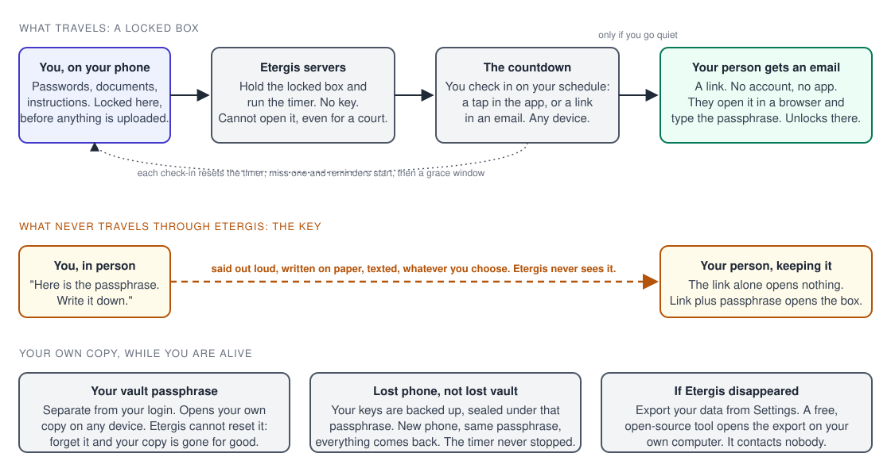

# How Etergis works, start to finish

Two emails are printed on etergis.com, word for word, because "will this actually
work" is the first question anyone asks about a product like this and the answer
should not be an adjective. This page is the rest of the answer: what happens between
the moment you type something into the app and the moment someone you chose reads it,
and what Etergis can and cannot see along the way.

Think of a safe-deposit box where the bank was never handed a key, with a kitchen
timer sitting on the lid. You wind the timer. If it ever runs out, the bank mails the
box to the people you named. They open it with a code you told them in person, and the
bank still has no key.

## 1. You put things in

Passwords, documents, account logins, instructions, the phone unlock code, the safe
combination. Anything your family or your team would need and could not find.

Everything is locked on your phone (or in your browser) before it is uploaded. What
reaches Etergis is the locked box: unreadable bytes plus the labels on the outside,
such as the title you gave the item and who it is for. We store the box. We never
receive the key. That is not a policy we promise to follow; it is how the software is
built, and the whitepaper linked below names every algorithm involved.

## 2. You say who gets what

You name each person and assign them specific items. Each person receives only what
you assigned to them, nothing else.

For each person you also set a passphrase, and you give it to them yourself: in
person, by phone, on a card in a drawer. That passphrase is the key to their copy, and
it never passes through Etergis. The dashed line on the diagram is the whole point of
the design: the key takes a different road from the box, and our servers are not on
it.

The day you add someone, they get this email (names changed, otherwise word for word
from the code that sends it):

> **Subject: Alex Rivera trusts you with something important**
>
> Alex Rivera added you as a trusted contact on Etergis.
>
> What that means: if Alex Rivera ever misses their check-ins, you'll get a secure
> link with exactly what they chose to leave you. Nothing to do right now. No account
> needed, no app to install.
>
> Etergis is a digital emergency plan. Alex Rivera's information stays encrypted until
> the moment you need it. We can't read any of it, and neither can anyone else.
>
> One small favor: tap this link to confirm this reached you, so Alex Rivera knows
> this address works when it matters.

That confirmation tap matters more than it looks. An emergency plan that depends on an
email address nobody has tested is a plan with a typo in it.

## 3. You check in

You pick a schedule. Every check-in resets the countdown. Miss one and reminders
start; let the deadline pass and a grace window opens (one hour by default, longer if
you set it) in which a single check-in still cancels everything. Only when the grace
window closes does delivery happen.

Checking in does not depend on your phone. A tap in the app works, and so does a link
in the reminder email, from any device that can read your mail. The clock itself runs
on our servers, not on your device, so a phone that is lost, dead, or in a drawer does
not stop the timer and does not fire it early.

Two shapes of timer ship today. A Lifeline runs on an ongoing schedule for the long
haul. A Safety Check-In runs once, for a specific window: a hike, a surgery, a trip.
Each has its own timer, its own people, and its own items. Family-plan owners can
also set an Emergency Keyword: text a private word from a verified phone and that
delivery starts without waiting out the countdown, with a cancel window in case it was
a mistake.

## 4. If you go quiet, the email goes out

When a countdown runs all the way down, each person you named gets this (again, names
changed, text as sent):

> **Subject: Alex Rivera left something important for you · Etergis**
>
> Dear Jordan,
>
> Someone important to you, Alex Rivera, prepared a secure package for you through
> Etergis, and it has now been released.
>
> We understand this message may arrive during a difficult time. We're sorry for the
> circumstances that brought it to you.
>
> To access what was left for you, visit the link below. You will need the passphrase
> that was shared with you separately.
>
> No account is required. Simply open the link, enter your passphrase, and the
> contents will be available to you.
>
> This link will expire after 30 days. Please save anything important.

They open the link in an ordinary browser, type the passphrase, and the unlocking
happens on their own screen. The passphrase is not sent to us; the browser uses it to
open the box locally. The link on its own opens nothing, for them or for us. Wrong
guesses are slowed down and the link locks after too many of them, so a stolen email
is a stolen envelope, not a stolen box. Links expire after 30 days, which is why the
email says to save what matters.

## 5. What Etergis can and cannot see

| We never see | We do see |
|---|---|
| The contents of anything you store | Your email address and your recipients' addresses |
| Attached files in readable form | The titles you give items, and who each one is for |
| Your vault passphrase | How big each locked box is |
| The passphrases you give your people | When you last checked in |
| The keys that open any of it | Whether your subscription is active |

A breach of our servers hands an attacker locked boxes. A court order gets the same
thing, because readable data is not something we hold. Both facts are true for the
same reason: the keys never arrive here.

## 6. The honest costs

Zero-knowledge is a trade, and the price should be on the label.

**You have two different passphrases, and they do different jobs.** Your *vault
passphrase* opens your own copy of everything, on any of your devices. The *delivery
passphrase* you set for each person opens their copy, and only theirs. The two are
independent: your family does not need your vault passphrase, ever, and you do not
need theirs.

**Forget your vault passphrase and your own copy is gone.** There is no reset link,
because a reset link would mean we could get in, and then so could anyone who got in
to us. The app checks passphrase strength when you set one and tells you to write it
down. Do that.

**Forget a delivery passphrase and that person's copy is unreadable.** While you are
alive, that is a two-minute fix: replace the passphrase and tell them the new one. The
risk is doing neither.

**Lose your phone and you have lost a phone, not the vault.** Your keys are backed up
to Etergis sealed under your vault passphrase, which we cannot open. Sign in on a new
device, enter the same passphrase, and your copy is back. Meanwhile the timer kept
running on our side, exactly as it should.

**If Etergis itself disappeared**, your copy still opens. Export your data from
Settings, then open the export on your own computer with
[etergis-recover](https://github.com/DannyBCarrJr/etergis-recover), a small
open-source tool that contacts nobody and does not need Etergis to exist. It was
written from the published whitepaper rather than from the app's source, and it is
tested against a real export on every change. That is the checkable version of
"we can't read your data": a second implementation, written separately, that opens
the same files.

## 7. The phone question

"What if the phone is the single point of failure?" is the right question to ask of
any product in this category, so here is the answer for this one, piece by piece.

- **Your information:** locked on the phone before upload, backed up locked, reopened
  on any device with the vault passphrase. The phone is a window, not the vault.
- **The timer:** runs on our servers. Your phone being off changes nothing.
- **Checking in:** app tap, or the link in the reminder email from any device.
- **Your account login:** email and password, with optional two-factor codes and
  single-use backup codes you can print. Losing the authenticator app is a recovery
  problem for your login, and your login is not what protects your information; the
  vault passphrase is.
- **Your people:** need an email address and a browser. No phone of theirs is
  involved, no app, no account, no two-factor enrollment at the worst possible time.

What Etergis does not do is get your family past the two-factor prompts on your
*other* accounts. It delivers what you stored: the passwords, the backup codes, the
instructions. Storing those is the plan. We carry the box; what you put in it is up
to you.

## Provenance

Every claim above is stamped the way Carr Digital stamps everything it publishes.

**Read from the running product and its source (Verified).** The two emails are the
production templates as printed on etergis.com on 2026-10-11, names changed. The
30-day link lifetime, the slow-down and lockout on wrong passphrase guesses, the
in-browser unlock with no passphrase sent to the server, the emailed check-in link,
the one-hour default grace window, the hashed single-use backup codes, and the sealed
key backup were each located in the application source on the same day.

**Stated in the public technical documents (Reported).** The algorithms, parameters,
and the zero-knowledge boundary are in [WHITEPAPER.md](WHITEPAPER.md) (document
version 2026-08-20) and [SECURITY.md](SECURITY.md) in this repository. The
recovery tool's design and its test against a real export are described in its own
[README](https://github.com/DannyBCarrJr/etergis-recover#why-you-should-not-simply-trust-this).

**Not claimed here (Proposed or absent).** Nothing on this page describes threshold
sharing, multi-approver release, or hardware keys. Those are roadmap items in the
whitepaper and do not protect anything today. "Post-quantum" is deliberately absent
from this page too: it applies to one specific copy of one key and the whitepaper
names which; it is not a property of the product as a whole.

If something here is wrong, email security@etergis.com and it will be corrected in
place with a note saying what changed.

---

Copyright 2026 Carr Digital LLC. Licensed CC BY-ND 4.0; see [LICENSE](LICENSE).
